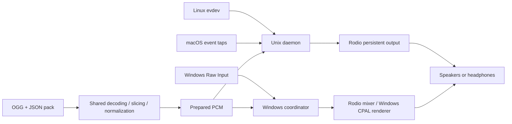

# Klicky

<p align="center"></p>

<p align="center"><strong>A little sound for every keystroke.</strong><br>Mechanical keyboard sounds for Linux, macOS and Windows 11 preview. Built with Rust.</p>

<p align="center"><a href="https://klicky.muneer320.tech/">Meet Klicky</a> · <a href="#install">Install</a> · <a href="https://klicky.muneer320.tech/guide.html">Field guide</a> · <a href="CONTRIBUTING.md">Contribute</a></p>

<p align="center"><a href="https://github.com/Muneer320/klicky/actions/workflows/ci.yml"></a> <a href="LICENSE"></a> <a href="docs/SOUND_PACKS.md"></a></p>

> **There's someone under your keys.**
>
> A click perks its ears up. A steady rhythm gets its little feet moving. Nobody knows quite what Klicky is. It just loves being there.

Klicky the app gives ordinary typing a little more character. Choose a sound pack, set the volume, and get on with whatever you're typing. Any keyboard will do. The mascot is imaginary; the software is a focused local utility, with no account, subscription or cloud sound service.

| A little detail | What it means for you |
|---|---|
| **10 included sound packs** | Cherry MX Black, Blue, Brown and Red with PBT/ABS variants, plus EG Oreo and EG Crystal Purple. [Listen before installing.](https://klicky.muneer320.tech/#sounds) |
| **Your sounds, your volume** | Choose a pack, adjust volume or add your own OGG/JSON recordings. |
| **Native desktop controls** | Windows tray; macOS menu toggle; Linux CLI and optional Omarchy bar control. |
| **Prepared audio** | Decode once when a pack loads, then reuse cached samples and a persistent mixer while typing. |
| **Local operation** | Normal playback stores no typed text and makes no network requests. [Permissions and privacy.](SECURITY.md) |

## Install

Choose your system. The helpers download, install and start Klicky, with platform permissions explained during setup. Prefer reading a script first? Inspect [install.sh](https://klicky.muneer320.tech/install.sh) or [install.ps1](https://klicky.muneer320.tech/install.ps1).

<details>
<summary><strong>Linux · Ubuntu / compatible Debian, Arch / Omarchy</strong></summary>

```bash
curl -fsSL https://klicky.muneer320.tech/install.sh | bash
```

Uses signed APT on **Ubuntu 24.04+ / compatible Debian amd64**, or the verified **Arch / Omarchy x86_64** package. Includes sounds and enables login startup. Use a terminal with curl and run as your user; package/device setup asks for sudo.

Compatible Omarchy shells get the bar toggle by default. Add `-s -- --no-omarchy-toggle` after `bash` to skip it. For Fedora, older systems and other architectures, use the automatic source build:

```bash
curl -fsSL https://klicky.muneer320.tech/install.sh | bash -s -- --source
```

[All Linux methods and prerequisites](docs/INSTALLATION.md#linux) · [Signed APT setup](docs/APT_REPOSITORY.md) · [Omarchy integration](docs/OMARCHY.md)

</details>

<details>
<summary><strong>macOS · source installation, menu bar included</strong></summary>

```bash
curl -fsSL https://klicky.muneer320.tech/install.sh | bash
```

Prepares missing Rust and Apple tools, builds Klicky, installs its menu control and enables login startup. First setup can take several minutes; approve Apple's tools dialog if shown.

Allow **`~/.local/bin/klicky`** in **System Settings → Privacy & Security → Accessibility**. Setup opens the pane and retries while you approve it. To skip the menu helper, add `-s -- --no-menu` after `bash`.

[macOS setup, source checkout and removal](docs/INSTALLATION.md#macos)

</details>

<details>
<summary><strong>Windows 11 · x64 unsigned preview</strong></summary>

Run in PowerShell:

```powershell
irm https://klicky.muneer320.tech/install.ps1 | iex
```

Downloads the published installer, verifies its SHA-256 and opens per-user setup. Choose login startup in the wizard; the helper starts Klicky afterward. No Rust, Visual Studio or elevation needed. Use the tray for packs, volume and Pause/Resume.

> [!NOTE]
> Windows downloads are development previews. If Windows Security reports a threat, stop setup and use the [security-block troubleshooting steps](docs/TROUBLESHOOTING.md#windows).

Prefer a file? The [Windows preview](https://github.com/Muneer320/klicky/releases/tag/windows-preview-2026-11-06) has an installer and portable ZIP. Extract the complete ZIP and open `klicky-desktop.exe`.

[Windows controls and recovery](docs/WINDOWS.md) · [Installation options](docs/INSTALLATION.md#windows)

</details>

Current downloads: **v0.4.0 Linux packages**, a separate **Windows preview**, and **macOS source setup**. [Releases](https://github.com/Muneer320/klicky/releases) · [Full installation guide](https://klicky.muneer320.tech/guide.html#installation)

## Make yourself at home

On Linux/macOS:

```bash
klicky list                       # See the available packs
klicky switch cherrymx-blue-pbt   # Choose your sound
klicky volume 0.5                 # Set volume, from 0 to 1
klicky status                    # Check the app
```

If a source-installed command is not on PATH, use `~/.local/bin/klicky`; Linux packages install `/usr/bin/klicky`. Windows has the same everyday CLI commands at its installed path:

```powershell
& "$env:LOCALAPPDATA\Programs\Klicky\klicky.exe" status
```

| Your desktop | Everyday controls |
|---|---|
| **Windows** | Tray: packs, volume, Pause/Resume, Retry audio and optional login startup. |
| **macOS** | Menu bar: toggle sounds. Terminal: pack and volume controls. |
| **Linux** | CLI and systemd; optional supported Omarchy bar toggle. |

<details>
<summary><strong>Start, stop and choose login startup</strong></summary>

```bash
klicky service start     # Start this session
klicky service stop      # Stop now; keep login startup
klicky service enable    # Start now and at login
klicky service disable   # Stop now and disable login startup
```

Windows supports these service commands too, through its installed CLI. Its tray also has **Start with Windows**. Windows may independently disable or defer startup. [Full CLI reference](docs/CLI.md)

</details>

<details>
<summary><strong>Configuration and your own sound packs</strong></summary>

| System | Settings folder |
|---|---|
| Linux | `~/.config/klicky` or `$XDG_CONFIG_HOME/klicky` |
| macOS | `~/Library/Application Support/klicky` |
| Windows | `%LOCALAPPDATA%\Klicky` |

`config.toml` contains two fields:

```toml
sound_pack = "eg-oreo"
volume = 0.8
```

Custom packs go in the neighboring `sounds` folder. Each pack contains `sound.ogg` and a JSON timing map. A user pack overrides a bundled/system pack with the same name. Use app controls for live changes.

[Configuration reference](docs/CONFIGURATION.md) · [Make a sound pack](docs/SOUND_PACKS.md)

</details>

## Under the keycaps

Klicky prepares audio when loading a pack, then selects cached PCM during typing. Platform adapters preserve the native input, controls and audio behavior of each system.



The Unix daemon and Windows coordinator have different concurrency and recovery designs. Cached audio and persistent output reduce work on keypresses; output hardware still affects perceived timing. [Architecture](docs/ARCHITECTURE.md) · [Performance and measurement](docs/BENCHMARKS.md)

## A few good questions

<details>
<summary><strong>Do I need a mechanical keyboard? Does Linux work on Wayland?</strong></summary>

Any ordinary keyboard works; the sound is added in software. Linux reads evdev below Wayland/X11, using a keyboard-only device rule rather than separate desktop-specific capture.

</details>

<details>
<summary><strong>Does it record what I type?</strong></summary>

Normal operation stores no typed text, logs no key names and sends no network requests. Global keyboard permission is sensitive, so grant it only to trusted software. Unix benchmark mode prints mapped key names and is for controlled tests. [Privacy and security](SECURITY.md)

</details>

<details>
<summary><strong>Why does Bluetooth feel delayed, or why are sounds missing?</strong></summary>

Compare speakers or wired output first; Bluetooth can add transport delay. Check state, pack, volume and the selected output. The [troubleshooting guide](docs/TROUBLESHOOTING.md) covers input permissions, startup, audio recovery and useful diagnostics. Report random missing sounds even if a restart helps.

</details>

<details>
<summary><strong>How do I update or completely uninstall?</strong></summary>

Update through your package manager or rerun the appropriate installer. [Update steps](docs/INSTALLATION.md#updates-and-removal)

Linux/macOS removal:

```bash
curl -fsSL https://klicky.muneer320.tech/uninstall.sh | bash
```

Windows installer removal:

```powershell
irm https://klicky.muneer320.tech/uninstall.ps1 | iex
```

These stop the app and remove installed desktop controls. Settings/custom sounds stay by default. [Explicit purge and portable removal](docs/INSTALLATION.md#uninstall)

</details>

## Find your way around

| I want to… | Start here |
|---|---|
| Install, configure or troubleshoot | [The website field guide](https://klicky.muneer320.tech/guide.html) |
| Look up commands or configuration | [CLI](docs/CLI.md) · [Configuration](docs/CONFIGURATION.md) |
| Add recordings or desktop integration | [Sound packs](docs/SOUND_PACKS.md) · [Omarchy](docs/OMARCHY.md) |
| Understand or contribute code | [Architecture](docs/ARCHITECTURE.md) · [Contributing](CONTRIBUTING.md) |
| Explore the character or use artwork | [Klicky's story](docs/CHARACTER.md) · [Brand assets](docs/BRANDING.md) |
| Check releases and project history | [Releases](https://github.com/Muneer320/klicky/releases) · [Changelog](CHANGELOG.md) |

Built on [Sauhard Gupta's original Klicky](https://github.com/Sauhard74/klicky), with subsequent work by Muneer Alam and contributors. [Acknowledgements](ACKNOWLEDGEMENTS.md) · [MIT license](LICENSE). Third-party notices accompany packaged downloads; the website's Nunito typeface retains its [SIL Open Font License](assets/website/fonts/OFL.txt).
