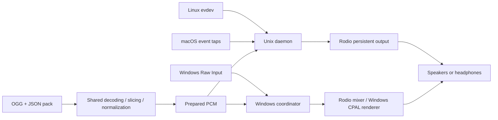
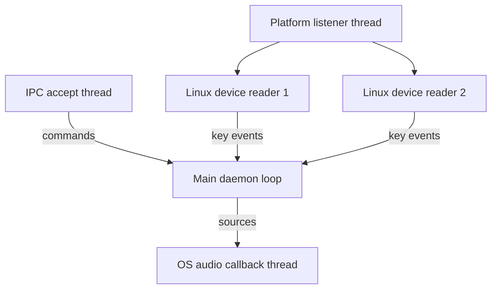
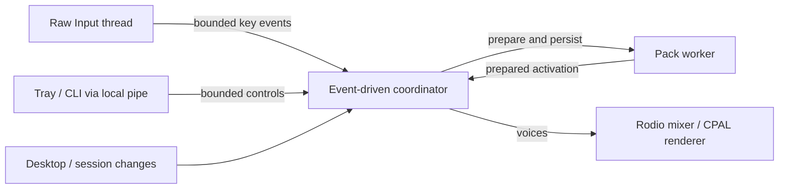

# Architecture

Klicky uses one resident process per user session. Linux/macOS retain their Unix daemon and service lifecycle; the Windows development preview has a native tray coordinator with separate input, audio and control adapters. Sound-pack preparation and mixer-facing types are shared. The library entrypoint selects the platform at compile time.

## Data flow



## Module map

| Module | Responsibility |
|---|---|
| `src/main.rs` | Thin executable entrypoint into the platform-selected library CLI |
| `src/lib.rs` | Shared types and compile-time platform entrypoints |
| `src/cli.rs` | Linux/macOS CLI dispatch |
| `src/engine.rs` | Linux/macOS daemon lifecycle, IPC handling, event draining and benchmark output |
| `src/config.rs` | Shared configuration fields and defaults |
| `src/config/unix.rs` | Unix configuration persistence, pack roots and runtime paths |
| `src/lifecycle.rs` | Persistent ownership lock, runtime cleanup, bounded shutdown and IPC readiness |
| `src/service.rs` | systemd user service and macOS LaunchAgent management |
| `src/ipc.rs` | JSON commands over a Unix domain socket |
| `src/listener.rs` | Shared `KeyEvent` contract and platform backend selection |
| `src/listener/linux.rs` | Linux device discovery, evdev reading, key mapping, key-down filtering |
| `src/listener/macos.rs` | Standard macOS key capture through `rdev` |
| `src/media_keys.rs` | Supplementary macOS media-key event tap |
| `src/soundpack.rs` | OGG decoding, per-key slicing, capped peak normalization, PCM caching |
| `src/player.rs` | Persistent Rodio mixer, low-latency output configuration, overlapping playback |
| `src/windows/runtime.rs` | Bounded Windows coordinator, transactional activation and confirmed component shutdown |
| `src/windows/input.rs` | Passive Raw Input thread, per-device repeat tracking and bounded event delivery |
| `src/windows/audio.rs` | Windows output supervision and route recovery |
| `src/windows/audio/sink.rs` | Windows-only CPAL 0.18.2 output retaining the Rodio mixer |
| `src/windows/transactions.rs` | Bounded asynchronous preparation, persistence and activation |
| `src/windows/control.rs` | Typed commands, delivery receipts and verified native process-exit waits |
| `src/windows/pipe.rs` | Current-logon protected local named-pipe transport |
| `src/windows/desktop.rs` | Native notification-area frontend, asynchronous controls and message loop |
| `src/windows/desktop/startup_worker.rs` | Owned asynchronous shortcut work and native exit confirmation before frontend teardown |
| `src/windows/session.rs` | Initial unlocked-session verification and lock, disconnect, power and logoff gating |
| `src/windows/cli.rs` | Windows CLI using verified control transport and ownership-guarded offline configuration |
| `src/windows/bundle.rs` | Cross-session bundle reader lease retained through process exit |
| `src/windows/startup.rs` | Per-user Startup shortcut ownership, atomic creation and exact-object removal |
| `src/windows/service.rs` | Background desktop launch and verified bundle-specific lifecycle |
| `src/bin/klicky-desktop.rs` | Windows GUI subsystem entrypoint; see the [development preview guide](WINDOWS.md) |

## Input backends

### Linux

Linux reads `/dev/input/event*` directly through `evdev`. This sits below Wayland and X11, so the same backend works in either desktop session.

At startup, Klicky:

1. Enumerates event devices.
2. Opens readable devices.
3. Keeps devices that advertise at least one mapped keyboard or media key.
4. Starts one blocking reader thread per selected device.
5. Emits only events with value `1`, the initial key-down value.

Release events (`0`) and kernel repeats (`2`) are ignored.

If any device reader ends or returns an error, the listener terminates the daemon with a failure status. The systemd unit restarts the process, which performs a fresh device scan instead of remaining alive without keyboard input.

The included udev rule adds `uaccess` only to devices tagged with `ID_INPUT_KEYBOARD=1`. Klicky itself remains unprivileged.

### macOS

Standard keys use `rdev`, which is backed by a macOS event tap. A second session-level event tap handles function-row media behavior on Mac keyboards. Both paths emit the same internal key names used by Linux.

### Windows preview

A message-only window on a dedicated thread receives passive Raw Input. Mapping tracks pressed keys per device and suppresses repeats. The callback sends bounded events without decoding audio, persisting settings or logging key names. The coordinator discards stale/obsolete events and disables capture when the session is inactive, locked or suspending.

The native tray frontend submits asynchronous controls. Sound-pack preparation and persistence run outside the coordinator and audio callback; activation follows successful preparation and persistence. Separate bounded input/control queues and reserved shutdown keep Quit responsive during load. Local control authenticates the current logon and retains the verified server process handle; a stop acknowledgement does not substitute for actual process exit.

## Sound-pack loading

Each pack contains one `sound.ogg` file and a `config.json` map of key names to `[start_ms, duration_ms]` ranges.

Loading a pack performs all expensive work up front:

1. Decode the complete OGG stream through Symphonia.
2. Convert timing ranges to interleaved sample offsets.
3. Copy each key slice into an independently shared buffer.
4. Raise quiet slices toward an 85 percent peak target.
5. Cap normalization gain at 6x.
6. Store slices in a hash map keyed by platform-neutral key names.

No decoding, filesystem access, or device initialization occurs on a keypress.

## Audio output

On Linux/macOS, Rodio 0.22 owns one `MixerDeviceSink`. Klicky attempts fixed output buffers in this order:

```text
256 frames -> 512 frames -> 1024 frames -> device fallback
```

Smaller buffers reduce control latency but are not supported equally by every backend. The fallback sequence preserves startup reliability without silently choosing a large default first.

Every keypress creates a lightweight source cursor over an `Arc<Vec<i16>>`. Samples convert to `f32` as the mixer consumes them. Multiple key sounds can overlap naturally.

Windows keeps the Rodio mixer but uses a Windows-only CPAL 0.18.2 renderer and a bounded voice pool. Endpoint-role notifications, stream errors and callback heartbeats drive recovery. Playback follows the default multimedia output and drops obsolete input during transitions. This adapter leaves the existing Linux/macOS output backend intact. Requested buffer sizes are not measured physical-to-audible latency.

## Concurrency

### Linux/macOS



The Linux/macOS main loop drains IPC and key-event channels, then sleeps for 500 microseconds. Input callbacks only map a key, capture an `Instant`, and send a channel message. Windows instead uses an event-driven coordinator with bounded work batches; its UI, startup worker, pack worker, input thread and audio renderer have explicit shutdown coordination.

### Windows



Pack preparation and settings persistence stay outside the coordinator/audio callback. Session gating and generation changes invalidate obsolete input; output supervision handles route/stream recovery. The native frontend, startup worker, input and renderer participate in confirmed shutdown.

## Runtime files

Klicky uses the operating system's config directory through the `dirs` crate.

Linux typically resolves to:

```text
~/.config/klicky/config.toml
~/.config/klicky/sounds/
/usr/share/klicky/sounds/
$XDG_RUNTIME_DIR/klicky/klicky.pid
$XDG_RUNTIME_DIR/klicky/klicky.sock
```

User sound packs are searched before system packs. Duplicate names resolve to the user copy, while `klicky list` merges both locations into one sorted list.

The runtime directory uses mode `0700`. The PID and socket use mode `0600`. When an operating system does not expose a runtime directory, Klicky falls back to a private `run` directory under its application config directory.

macOS typically resolves under:

```text
~/Library/Application Support/klicky/
```

Windows stores configuration/custom packs under `%LOCALAPPDATA%\Klicky`, with session-specific runtime ownership under `run\session-<id>`. Bundled packs resolve beside the executable, independently of its working directory. A retained `.klicky.bundle.lock` reader protects each active bundle through native process exit. The installer takes that marker exclusively before replacing/removing files; another logged-on session blocks mutation. The installer preview and its recovery limits are described in the [Windows guide](WINDOWS.md).

## Known constraints

- Linux input devices are discovered at daemon startup. A newly added keyboard requires a daemon restart, while a lost reader causes a systemd-managed process to restart and rediscover devices.
- Linux/macOS physical audio-device replacement and suspend/resume need additional runtime testing after the Rodio 0.22 migration. Windows implements recovery, with its hardware matrix still under qualification.
- Benchmark mode measures input callback to mixer dispatch, not microphone-observed audible latency.
- Windows 11 x64 is a development preview. Calibrated physical latency, matched Linux/macOS baselines, additional hardware and full installation/session/reliability qualification remain open.

These constraints are intentionally explicit. They should become focused issues rather than hidden claims of universal support.
