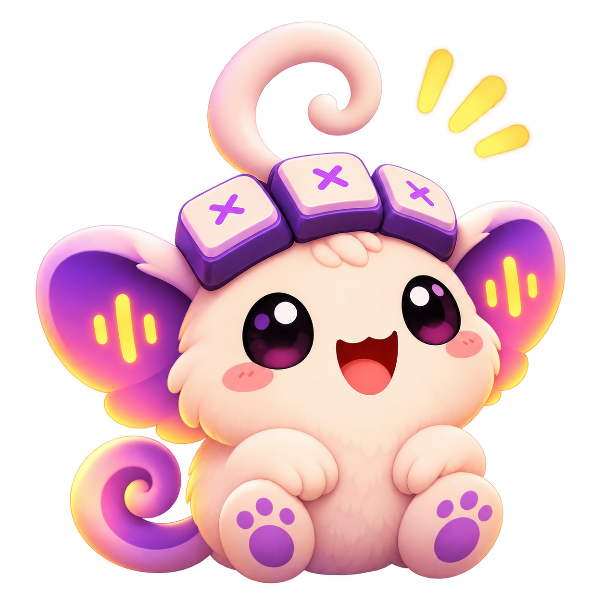

# There's someone under your keys.

Somewhere beneath the keycaps lives a tiny creature named **Klicky**.

Nobody knows quite what it is, or how it got there. We do know that it absolutely loves sounds.

A single click perks its ears up. A steady rhythm gets its little feet moving. When the keys really get going, its tiny world becomes a very happy place.

And when you stop? Klicky settles down. A little quiet is good, too.

**Klicky. A little sound for every keystroke.**

## A recognizable little mystery

Klicky is curious, cheerful, affectionate and a little mischievous. It is never needy: no guilt for taking breaks, no demand to keep typing. Its species, age, origins and wider world stay deliberately unexplained.

The visual anchors are its warm cream body, broad violet ears carrying sound bars, three little forehead keycaps and curled antenna. Those features should remain recognizable in a detailed illustration or a simple monochrome icon.

The mascot is a fictional brand character. The app is a local Rust keyboard-sound utility, with no AI companion, virtual-pet simulation, streaks or rewards.

For the actual software, start with the [field guide](https://klicky.muneer320.tech/guide.html). For artwork and visual consistency, see the [brand guide](BRANDING.md).
